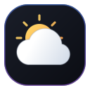

# dsh-weather-island

> DeepSeek Harness（DSH）天气插件 **v2.1**：**可拖动的灵动岛式悬浮天气看板**。
> 6 大数据源（Uapi、Open-Meteo、wttr.in、彩云天气、OpenWeatherMap、墨迹天气爬虫），最多 2 源并排对照，默认 **Uapi（主）+ Open-Meteo**，均免 Key、开箱即用。
> 界面自动适配 DSH 深色 / 浅色主题，玻璃透明度可调；卡片大号温度旁带**实时时钟**；预报支持 **3 / 5 / 7 日**；位置只认「拖动落点」，点击不再跑位。



## ✨ v2.1 修复与新增

### 🎨 场景化卡片背景（新增）

卡片背景不再是一成不变的蓝紫极光，而是**随当前天气与昼夜自动切换**的 7 套配色，
大温度渐变、度数符号与细节层全部联动，切换时 1.6s 平滑过渡。
7 套场景按**色相错开**设计（暖橙 / 靛蓝 / 青灰 / 青蓝 / 紫红 / 冰蓝 / 浊黄绿），
并用 `--dwi-scene-aurora`（深 .45 / 浅 .55）独立强度保证浅色主题下也肉眼可辨：

| 场景 | 判定 | 配色 | 细节层 |
| --- | --- | --- | --- |
| 晴昼 `day_clear` | 晴 + 白天 | 金橙暖阳（Hue 35） | — |
| 夜间 `night` | `isDay=false` | 靛蓝（Hue 230） | ✨ 14 颗闪烁星星 |
| 多云 `cloudy` | 多云/阴/大风 | 低饱和青灰（Hue 200，静态沉闷感） | — |
| 雨 `rain` | 雨/阵雨/毛毛雨 | 高饱和青蓝（Hue 197） | 💧 12 条雨丝下落 |
| 雷暴 `storm` | 雷 | 乌云紫红 + 电紫（Hue 290） | 💧 12 条雨丝下落 |
| 雪 `snow` | 雪 | 近白冰蓝（全场最亮） | ❄️ 12 片飘雪粒子（慢速摇曳下落） |
| 霾 `haze` | 霾/沙/浮尘/雾 | 浊黄绿（Hue 58） | 🌫 两团缓慢平移的浑浊光带 |

- 配色经**确定性验证**（`scene-contrast.cjs`）：14 组深浅背景 × 文字对比度全部 ≥ 7.2:1
  （WCAG 正文标准 4.5:1 的 1.6 倍）；场景两两区分度 ΔE 跨色系 ≥ 12 / 蓝系 ≥ 8 / 暖色对 ≥ 11。
- 浅色主题下夜间/雷暴呈「黄昏」观感（最暗的天气允许偏暗，对比度仍 ≥ 7.2:1）。
- 新增**噪点纹理**层压住大面积渐变的「塑料感」；`prefers-reduced-motion` 下所有场景动画自动停。
- 设置页「外观 → 场景化背景」可一键关闭（回落固定蓝紫，视觉与旧版零差异）。

### 🐛 关键修复

- **截图脚本单图全同 BUG**（ui-screenshot.cjs）：旧版 8 张「单状态截图」复用同一个
  HTML + `#fragment` 锚点，而 fragment 不改变渲染 → 8 张图全是第一张卡的副本。
  改为每状态独立生成 HTML，并同步新增逐状态的几何/fx 断言。
- **未配代理时不再重发主端点**（网络层）：旧版端点表里的 proxy 项在未配置 CORS 代理时会
  把主端点**原样再打一遍**（代理 URL 退化为直连），白白多消耗一次访客速率桶
  （visitor-rate 4 次/秒）额度，越切换越容易 429。现在 `fetchEndpoints` 直接跳过。
- **备份端点超时收紧到 ≤9s**：避免「主端点等 11s + 备份再等 11s + 下一跳再 11s」把用户晾 30s+。
- **竞态守卫 `loadSeq`**：快速连点刷新/换城时，慢的旧请求晚返回**不再覆盖新数据**
  （此前会出现数据「倒退」一闪）。清 spinner 用独立的 busy 序号，
  「GPS 定位中点刷新」不会把转圈卡死。附行为级验证（render-smoke 慢 11° vs 快 22° 调度模拟）。
- **补上 README 曾承诺但未实现的「失败汇总 + 重试」块**：`.dwi-err` 的 CSS 一直在、
  却从未渲染过节点。现在有失败源时在双源对照卡下方给出汇总行 + 一键重试；
  两源皆败时升级为醒目的 `dwi-errAll` 态（单源失败为中性信息色，不虚张声势），
  胶囊同时显示「⚠️ 数据源失败」而不是含糊的「—°」。
- **修复 `.dwi-tip` 引用未定义变量**（`--dwi-line`/`--dwi-fg`）导致生活指数胶囊的边框与文字颜色失效。
- **修复 `httpTextOnce` 中的重复 `return`**（死代码）。
- **补上胶囊 U 键**：title 一直写着「快捷键 U」但没实现，现在胶囊聚焦时 U 真的可切换 °C/°F。
- **浅色主题次级文字加深**：`--dwi-dim` 由 `#87919f`（对浅底仅 2.8:1）加深至 `#5f6a79`
  （4.6:1），标题旁的「地区 · 定位方式 · 数据源」等说明文字不再发虚。

### 🌐 定位强化

IP 定位从单源升级为**双源自动回退**：`ipwho.is`（主）→ `ipapi.co`（备份，免 Key、CORS 友好）。
主源抖动时首屏不再直接报「定位失败」；双源皆败时报主源错误并附备份源原因。

### 🎛 设置页视觉重做

- **hero 横幅**：与悬浮卡片同源的「极光 + 玻璃」语言（浮动光斑 + 🌤️ 图标底座 + 状态 chip），
  一眼看出是同一个插件。
- **分段控件**：选中态改为品牌渐变（135° 蓝→蓝紫）+ 柔和投影，未选中 hover 有反馈。
- **滑杆**：webkit/moz 双引擎定制 thumb（白底蓝描边圆点，hover 放大 1.15×、按下 1.28×），
  轨道带进度填充（`--dwis-fill` 变量驱动）。
- **开关**：选中态渐变 + 弹簧位移；输入框 focus 带品牌色光环。
- 新增「场景化背景」开关行；操作说明补 U 键与搜索键盘导航。

### 🖱️ 交互细节

- **搜索建议键盘导航**：↑/↓ 在建议列表移动（高亮项带左侧蓝条），Enter 选中（默认第一项），
  Esc 关闭搜索框（此前 Esc 会直接收起整卡）。
- **逐时条右缘渐隐**：提示「还有更多可横滑」，滑到底自动淡出（`.dwi-scrolled-end`）。
- 双源皆败时胶囊显示「⚠️ 数据源失败」态，点开即可看到各源具体原因与重试按钮。

## ✨ v2.0 修复与新增

### 🐛 关键修复

- **Uapi「人人无法获取数据」→ 多端点 + 出错自动切换**（本轮重点）：
  实测排查确认**接口本身正常**（`uapis.cn` 免 Key、CORS 正确反射 Origin），失败来自三个真实成因：
  1. **免费额度按访客 IP 计**：响应头 `Ratelimit-Policy` 含 `visitor-rate;q=4;w=1`（4 次/秒），
     且带 `Uapi-Stop-On-Empty: true`。双源并行 + 失败重试极易超过 4 次/秒 → **429**。
  2. **服务端已给 `no-store`**，旧代码却额外发 `cache: "no-store"`，绕开 CDN 缓存、更易触发限流。
  3. 官方 SDK 文档明确「**浏览器端只适合临时 Demo**」，错误码表里有 `CORS_FORBIDDEN(403)`
     → 浏览器直连随时可能被防盗链/跨域策略拦截。

  **修复**：
  - **多端点自动切换**：主端点失败时按序自动切到等价端点，**界面无感**——
    ① `uapis.cn` 直连（主） ② 用户自配 CORS 代理（若填了） ③ `wttr.in`（同为城市名语义，实测 `ACAO:*`）
    ④ `open-meteo` 地理编码 → 预报（实测 `ACAO:*`，按经纬度）。
    备份源结果统一归一化成 Uapi 同形结构（含英文描述→中文映射），展示完全一致。
  - **端点健康冷却**：失败端点进冷却并按 `Retry-After` 让路，避免对已挂端点反复冲。
  - **业务错误不乱切**：`404/400/401` 直接上抛（1 次请求、0ms 返回），不产生无意义请求。
  - **不内置公共 CORS 代理**：2026-02 实测 `allorigins` 522/超时、`corsproxy.io` 401 需付费 Key、
    `codetabs` 522、`thingproxy` 502、`r.jina.ai` 502 —— 内置只会白等 10–20s 再失败，已全部剔除。
  - 去掉 `cache: "no-store"`；Uapi `retry` 由 1 改 0（适配器内部已做多端点切换，外层再叠重试会打满额度）。

- **Uapi 接口 2026-02-19「重大升级」后取不到数据**（[官方更新日志](https://uapis.cn/docs/changelog)）：
  接口本身一直正常，是插件还按**升级前的响应格式**解析。已按新契约重写：

  | 变更点 | 升级前 | 升级后 | 修复方式 |
  | --- | --- | --- | --- |
  | 错误码 | `502`、`404 LOCATION_NOT_FOUND` | 新增 `503`、`404 NOT_FOUND` | 按新错误码表映射；**4xx 常回空响应体**，改用状态码兜底文案 |
  | 逐时时间 | `"2026-10-11 15:40:08"` | ISO8601 `"2026-02-19T17:00:00+0900"` | 新增 `parseIso` 带时区偏移安全解析 |
  | `report_time` | `"8 分钟前发布"` | `"2026-02-19 15:25:58"` | 新增 `normalizeReportTime` 归一为可读短串 |
  | `weather_icon` | 总是返回 | 可能缺失 | 图标改为 `weather_code → weather_icon → 中文文本` 三级回退 |
  | 无城市名 | 报错 | 支持 IP 自动定位 | 省略 `city` 走自动定位，并回填 `city·district` 到标题 |
  | 风速 | 只能从 `hourly[0]` 借 | `forecast[].wind_speed_day` 也有 | 多级回退，风速不再经常为空 |
  | 新增能力 | — | `minutely` 分钟级降水、`indices` 18 项生活指数、`aqi_level`/`aqi_primary`/`air_pollutants` | 全部兼容取值，详细数据面板补「主要污染物 / 短临降水」 |

- **Uapi「signal is aborted without reason」**：
  根因是旧版 `AbortController.abort()` 不带原因、12s 一刀切超时、失败不区分原因。
  现在：`abort(reason)` 带 `TimeoutError`；每个源独立超时（Uapi 11s）；
  先 `text()` 再 `JSON.parse`，把接口的 4xx / 5xx / 非 JSON 都翻译成中文可读原因（含 `Retry-After`）。

- **灵动岛记忆 = 拖动落点（而非点击后的位置）**：
  旧版展开/收起会改变根节点尺寸，触发重钳逻辑把胶囊「搬」到别处——记住的反而是被搬动后的位置。
  现在卡片绝对定位挂在锚点旁，**不参与根节点尺寸计算**：
  纯点击完全不写位置；拖动只在抬起时提交一次落点（拖动中用局部状态渲染，不再每帧写 localStorage）。

- **CORS 代理默认关闭**：旧版默认挂第三方代理 URL，代理抖动直接把快源拖超时。
  现在默认全部直连；仅非 CORS 源（墨迹爬虫）或 Uapi 被拦时在设置里手动开启，支持 `{{url}}` 占位符。

- **日期标签「今天」曾被误判为「明天」**（影响全部数据源）：
  `dayLabel()` 拿当前时刻（如 20:24）与「今天零点」相减得 0.85 天，`Math.round` 进位成 1 → 显示「明天」。
  现已把两侧都归一到 00:00 再比较；`今天/明天/后天/周三…` 全部正确。

- **墨迹天气：删除 apihz 中转 API，改为网页爬虫**（详见下方「墨迹爬虫」）。

### 🕷️ 墨迹爬虫（v2.0 重写，已删除 apihz 中转 API）

数据来源：**直接爬取 [tianqi.moji.com](https://tianqi.moji.com/) 真实网页**，带真实浏览器请求头
（`Chrome/131` UA、`Accept`、`Accept-Language: zh-CN`、`Sec-Fetch-*` 等），不再需要任何 Key。

抓取路径（实测 2026-10 页面结构）：

| 数据 | 来源 | 页面锚点 |
| --- | --- | --- |
| 实况温度/天气/更新时间 | `/weather/china/{省}/{市}` 或首页 `/` | `div.wea_weather` 的 `<em>` / `<b>` / `.info_uptime` |
| 湿度 / 风向风力 | 同页 | `div.wea_about` 的 `湿度 64%` / `东南风1级` |
| 当前 AQI | 同页 | `div.wea_alert` 的 `<em>101 轻度污染</em>` |
| 天气提示 | 同页 | `div.wea_tips em` |
| 多日预报（≤7 天） | `/forecast7/china/{省}/{市}` | `div.wea_list_seven` 每 `<li>`：`<b>`=最高、`<strong>`=最低、`span.week` 星期/日期 |
| 生活指数（30 项） | 实况页 | `div#live_index` 的 `<dt>等级</dt><dd>名称</dd>` |
| 省/市 slug（按 IP） | `/api/iplocate` | 返回一行 `/weather/china/sichuan/pidu-district` |

**关键工程约束（都已实测确认并处理）**：

1. **站点无任何 CORS 响应头** → 浏览器里**必须**配 CORS 代理才能读取（Node/服务端直连无碍）。
   未配代理时会明确提示「该站未开放跨域读取，请在设置里填写 CORS 代理」，而不是含糊报错。
2. **前置 CloudWAF**：短时间多次请求会返回 **HTTP 418 +「访问被拦截！」** 页面，封禁约 5–10 分钟。
   因此实现了 **全局限速 + 单飞串行**（`MOJI_MIN_GAP_MS = 12s`，同一时刻只发 1 个请求），
   并主动识别 WAF 页并抛出可重试错误（而非把拦截页当正常页解析）。
3. **不切换地区**：按需求**不做地区切换 UI**。首页按客户端 IP 自动定位；多日预报则先用
   `/api/iplocate` 换取「按 IP」的省/市 slug 再取，所以**无需用户选地区也能出多日预报**。
4. 预报列表**可能包含「昨天」**（实测页面自称今天 10/11、列表却从 10/10 开始）→ 已按日期去重并
   丢弃早于今天的条目；并用实况页当天的权威数据覆盖第一行。
5. 「无地区」时 `/forecast7/china`（全国页）不含城市数据 → 已确认并在无 slug 时优雅退化为「仅当天」。

**已做的多轮真实验证**：5 城市 × 多轮抓取，实况/湿度/风力/AQI/7 日预报/30 项生活指数全部正确解析；
期间复现并修掉了 3 个真实 bug：`fetchHtml` 空地址（`withProxy` 返回 `null` 时）、
小响应被「过短」误杀（`/api/iplocate` 仅 36 字节，改用 `minLength`）、
以及全源共用的 `dayLabel` 今天/明天错位。

### 👋 首次加载欢迎指引

第一次打开时，胶囊会**在首帧直接展开一张欢迎指引卡**，用 5 步讲清「它是什么 / 怎么用」：

| 步骤 | 主题 | 讲什么 |
| --- | --- | --- |
| 1 | 👋 欢迎 | 这是什么、点一下能展开 |
| 2 | 🖐️ 拖动 | 拖着放到顺手的角落，落点会记住；双击复位 |
| 3 | 🌤️ 展开 | 逐时 / 多日 / 生活指数 / 双源对照；天数可切 3·5·7 |
| 4 | 📍 定位 | 默认 IP 定位；搜索或 GPS 换城市 |
| 5 | ⚙️ 微调 | 主题 / 字号 / 透明度 / 数据源的入口 |

**设计上刻意克制，不新增视觉体系**：
- **首帧就展开**（`useState(() => !settingsStore.get().seenGuide)`）——
  避免「先看到胶囊、再弹出指引」的跳动闪烁。
- **动态来自三处细节，而不是到处乱动**：顶部柔光条随步骤做 0.75s 颜色过渡；
  环绕光弧 `dwi-orbit` 缓慢旋转（6.5s/圈）；主按钮 4.2s 一次的掠过式高光
  （末步按钮自动停，不让「开始使用」一直闪）。
- **和谐**：复用卡片同款「极光 + 玻璃 + 弹簧」语言（`dwi-guide-card` 的玻璃背板与
  `dwi-anchor dwi-pop` 入场动画与看板完全一致），只有首次入场与步骤切换两处动画。
- 支持**键盘**（← / → 翻页，Esc 跳过）与**点进度点直接跳步**；
  末步按钮文案切为「开始使用 ✓」。
- 看过后写入 `settings.seenGuide`，之后**不再自动弹出**；
  设置页「操作方式与本地数据 → 欢迎指引 → 再看一遍指引」可随时重播
  （设置页与悬浮卡片是两个独立插槽，重播请求走 `guideReplay` 轻量广播，不落盘）。
- 同样遵循 `prefers-reduced-motion`：关掉动画但保留步骤切换。

### 📈 功能

- **三日 / 五日 / 七日预报**（默认三日；Uapi 的 `forecast` 本身一次给 7 天）。
- **分钟级降水（短临）**：按文档请求 `minutely=true`，摘要进「详细数据 → 短临降水」（仅国内城市有数据）。
- **生活指数卡片**：按文档请求 `indices=true`，展示穿衣/紫外线/舒适度/运动/洗车/晾晒等（最多 8 项，
  悬停可看完整建议）；国际城市同样可用。
- **双源对照卡可点选设为主源**（★ 主源标记），主源失败自动按优先级回退。
- **手动城市持久记忆**：卡片内搜索选定后记住，可设为启动定位方式「上次手动」。
- 逐时最多 24 格 + 降水概率；详细数据补齐体感/风力/云量/降水/日出日落/主要污染物，最多 12 格。
- 页面**后台自动暂停轮询**，回到前台若过期立即补一次。
- 失败一键「重试」；胶囊键盘可达（Enter/Space 展开，R 刷新，Esc 收起）。
- 设置页为需 Key 的源（彩云/OpenWeather）提供**「获取 Key ↗」直达官网申请页**与「文档 ↗」；免费源不打扰。

### 🎨 界面与主题

- 主题三选：**自动（跟随 DSH/系统）/ 强制深色 / 强制浅色**；MutationObserver 实时响应 DSH 切主题。
- 深浅令牌去重为「深色默认 + 浅色覆盖」两套；玻璃背板独立成 `::before` 层——
  **透明度滑杆（45–100%）只调背板，文字始终满不透明**。
- 卡片温度放大至约 **3.9 倍字号**（渐变描边），右侧新增**实时时钟**（默认 HH:MM，**可开秒**；点击卡片时钟也可快切）。
- 「详细数据」小卡片、逐时格、单日行、双源卡、搜索建议**全部加悬停效果**（升起、描边、渐变下划线）。
- 卡片智能弹出：锚点靠近顶部往下展开、靠近底部往上展开，水平自动防出界。
- 页脚每 60s 心跳刷新「x 分钟前」；AQI 显示六级色点。

### 📐 与官方文档的对齐（实测校验）

逐字段比对了 [官方文档](https://uapis.cn/docs/api-reference/get-misc-weather) 与线上真实响应，修正了三处偏差：

| 项 | 文档 | 实测 | 处理 |
| --- | --- | --- | --- |
| 图标码 | 建议用 `weather_code` | **只返回 `weather_icon`**（和风码 100/101/502…），`weather_code` 未返回 | `pickInfo` 改为 **`weather_icon` 优先**，`weather_code` 保留兼容；`hourly` 两者都没有 → 走中文文本 |
| `forecast[].wind_speed_day` | 文档字段表列出 | **实测未返回** | 保留为回退项；风速主取 `hourly[0].wind_speed` |
| `minutely` / `indices` | 文档列为可选模块 | **必须显式传参才返回** `minutely_precip` / `life_indices` | URL 补上 `minutely=true&indices=true` |

## 📦 仓库结构

```
dsh-weather-island/
├── index.js              客户端半身（~4000 行）：数据源、场景化渲染、设置页
├── host.js               host 半身：静态资源与注入
├── cordis.patch.yml      插件清单
├── icon.svg              图标
├── package.json          version 2.1.0
├── verify-client.cjs     离线自检（单元断言，含 v2.1 专项）
├── render-smoke.cjs      渲染冒烟（React 元素树 + 指引逐步渲染 + 竞态守卫行为）
├── guide-visual.cjs      指引视觉检查（真实浏览器测量）
├── guide-interact.cjs    指引交互检查（真实浏览器点击走完全程）
├── scene-contrast.cjs    场景配色确定性验证（对比度/区分度/fx 断言）
├── ui-screenshot.cjs     完整看板 8 状态截图（独立页）+ 几何断言
├── ui-pixel-verify.cjs   像素级独立验证（单图唯一/色相/粒子/对比度）
├── settings-screenshot.cjs 设置页截图 + hero/渐变断言
├── live-probe.cjs        真实网络验证（Uapi 多端点/自动切换等）
├── moji-live-probe.cjs   墨迹爬虫真实网络验证（可传轮次）
└── shots/                截图输出目录（自检产物，已 gitignore）
```

## 🗂️ 数据源

| 源 | Key | CORS | 覆盖 |
| --- | --- | --- | --- |
| Uapi (`uapis.cn`) | 免 | ✓ | 实况+体感/AQI及污染物+逐时+**7 日**预报+分钟级降水+18 项生活指数；**失败自动切换**到 wttr.in / Open-Meteo |
| Open-Meteo | 免 | ✓ | 按经纬度、预报最全（WMO 码） |
| wttr.in | 免 | ✓ | 独立第二源，交叉校验 |
| 彩云天气 | Token | ✓ | 分钟级降水；接口为「经,纬」顺序 |
| OpenWeatherMap | Key | ✓ | current + 5day/3h 聚合 |
| 墨迹天气 | 免 | 需代理 | **网页爬虫**：实况+湿度/风力/AQI+**7 日**预报+生活指数；按 IP 定位，不支持切地区 |

- **IP 双源回退（ipwho.is → ipapi.co）+ GPS(浏览器定位+BigDataCloud 反查) + 城市搜索(Open-Meteo Geocoding)** 定位。
- **localStorage 缓存**首屏即时上屏；设置即时生效；`prefers-reduced-motion` 自动降级动画。

## ✅ 自检

```bash
node verify-client.cjs        # 离线单元断言（含 v2.1 场景/竞态/代理过滤/汇总块断言）
node render-smoke.cjs         # 渲染冒烟（含欢迎指引逐步渲染 + 竞态守卫行为验证）
node guide-visual.cjs         # 指引视觉检查（真实浏览器测量，无浏览器则 SKIP）
node guide-interact.cjs       # 指引交互检查（真实浏览器点击走完 5 步，无浏览器则 SKIP）
node scene-contrast.cjs       # 场景配色确定性验证（对比度 ≥4.5:1 + 区分度 ΔE 分层阈值）
node ui-screenshot.cjs        # 完整看板 8 状态截图（每状态独立页）+ 几何断言
node ui-pixel-verify.cjs      # 像素级独立验证（单图唯一性/场景色相/雪粒子/文字对比，需 DSH Python）
node settings-screenshot.cjs  # 设置页截图 + hero/渐变断言
node live-probe.cjs           # 真实网络（Uapi 多端点/自动切换）
node moji-live-probe.cjs 3    # 墨迹爬虫真实网络（3 轮）
```

> `guide-interact.cjs` 在真实浏览器里点完「下一步 ×4 → 开始使用」，
> 验证步骤确实依次推进、进度点的「高亮/已完成」计数正确、首步「上一步」禁用、
> 末步文案切为「开始使用 ✓」且不提前结束，并断言 5 步卡片高度完全一致。

> `guide-visual.cjs` 会从 `index.js` 直接抽 CSS 与步骤文案，在 Edge/Chrome 无头模式下
> **实测**指引卡片的几何：深浅两套主题 × 5 步共 10 张卡片必须尺寸完全一致（否则切步时卡片抖动）、
> 内容不溢出/标题不裁切/图标与文字不重叠、玻璃模糊确实生效、末步按钮高光已停。
> 找不到浏览器时打印 `SKIP` 并以 0 退出（可用 `DSH_BROWSER` 指定路径）。

`verify-client.cjs` 覆盖：四件套导出、双槽注册、6 源注册表、清洗器（越界回落/未知键丢弃/pos 形状）、
超时→中文翻译、空响应体 4xx 兜底文案、`Retry-After` 透出、200+新版业务错误码拦截、
`parseIso` 时区偏移解析、`reportTime` 归一化、Uapi 新契约归一化（`aqi_level`/`air_pollutants`/
`district`/IP 自动定位）、**官方文档对齐**（`weather_icon` 优先级、`minutely=true`/`indices=true`
必须传参、生活指数透出与展示）、**多端点自动切换**（429/403/5xx 换端点成功、404 不切换只发 1 次、
全失败给可读原因、端点健康冷却、公共代理已剔除）、重试只针对瞬时错误、缺 Key 不发请求、AQI 六级、
**墨迹爬虫解析**（实况/湿度/风力/AQI/提示、`wea_list_seven` 的 `<b>`=最高·`<strong>`=最低、
生活指数、星期与日期换算含跨年）、**`dayLabel` 今天/明天回归测试**、
`fetchHtml` 的 `minLength` 与 CloudWAF 识别、**首次欢迎指引**（步骤数据完整性、
`seenGuide` 默认值/持久化/脏值清洗、旧版设置键平滑升级、跨插槽重播广播的订阅与容错、
首帧展开的源码断言）、v2.0 全部修复点的源码断言，以及 **v2.1 专项**（场景映射 `sceneOf`
七场景判定、场景三色合法性、`sceneBg` 默认值与脏值清洗、场景变量写入根节点、
`loadSeq` 竞态守卫四处比对、失败汇总块 `failSummary`/`dwi-errAll`/全败胶囊态、
搜索键盘导航 `sugIdx`/`dwi-sugOn`、U 键、未定义变量与重复 return 回归、
IP 双源回退、备份端点超时收紧、代理端点过滤）。

`moji-live-probe.cjs` 为墨迹爬虫的**真实网络**验证脚本（可传轮次：`node moji-live-probe.cjs 3`），
覆盖首页(IP)与多个城市的详情页路径，并统计跨轮次的成功率。

## 🎛️ 设置项（DSH 设置 → 天气看板）

- **外观**：主题（自动/深/浅）、字号 12–22px、玻璃透明度、**场景化背景开关**、°C/°F、时钟显示秒、
  预报 3/5/7 日、逐时开关、悬停即展开、自动刷新 5/10/15/30 分、位置复位。
- **数据源**：6 选最多 2，勾选顺序即主源优先序；需 Key 的源就地填 Key + **获取 Key ↗** / **文档 ↗** 链接。
- **定位与网络**：启动定位方式（IP / GPS / 上次手动）、已记住城市一览、CORS 代理（默认留空直连，支持 `{{url}}`）。
- **操作方式与本地数据**：快捷键说明（Enter/Space/R/U）、**欢迎指引（再看一遍）**、清除天气缓存、恢复默认设置。

## 🌐 数据来源

- Uapi `uapis.cn/api/v1/misc/weather`（免 Key，CORS；`extended/forecast/hourly/minutely/indices` 全开，
  支持 `city`/`adcode`/IP 自动定位；被限流或被拦时自动切换 `wttr.in` / Open-Meteo，界面无感）
- Open-Meteo `api.open-meteo.com/v1/forecast`（免 Key，CORS）
- wttr.in `wttr.in/<lat>,<lon>?format=j1`（免 Key，CORS）
- 彩云天气 `api.caiyunapp.com/v2.6/{token}/{lng},{lat}/weather.json`（免费 Token）
- OpenWeatherMap `api.openweathermap.org/data/2.5/weather` + `/forecast`（免费 Key）
- 墨迹天气 `tianqi.moji.com`（**网页爬虫**，免 Key；无 CORS 头 → 浏览器需代理；前置 CloudWAF，已限速）
- 定位：ipwho.is → ipapi.co（IP 双源回退）+ 浏览器 Geolocation + BigDataCloud 反查 + Open-Meteo Geocoding

> 任一源失败不影响其它：对照卡显示该源的具体中文原因；两源皆败时页脚上方给出汇总与「重试」。

## 🖱️ 交互

- **单击胶囊/卡片头部** → 展开 / 收起（不改变位置）。
- **拖动** → 移动浮动位置，抬起时记住落点。
- **键盘**：Enter/Space 展开，R 刷新，Esc 收起。
- **搜索图标** → 输入城市名（Open-Meteo Geocoding 建议）→ 选定后记住该城市。
- 对照卡上的 **★** → 把该源设为主源。

## 📄 License

MIT（见 [LICENSE](./LICENSE)）。
